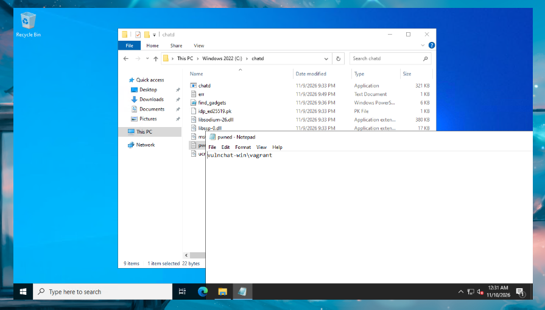

# Binex Vulnerable Service / Chatroom

##### Darwin Tran, Gavin McConnell, Odessa Rybski

## Description
Our service will be made up of a chat service and an authentication service. We’ll have both Linux and Windows clients that will access the chat service. When the user attempts to access the chat service, they will be redirected to the auth server (via SAML standards, or just Kerberos) and then sent back to the chat server. The authentication server will be vulnerable via the user ID and the chat service will be exploitable through “/” commands. Both cases will be vulnerable to buffer overflow attacks, but the chat service will also be vulnerable to use-after-free when message length . The authentication server will be written for Linux and will be compiled with the NX bit set (DEP). The idea is that we would dereference the static address of a libc function on the .plt.got section and use an add operation to get the address of mprotect. It shouldn’t be too hard to include the gadgets for this and to make sure that bit operations with a stack address being leaked are included as well. We will not be using stack canaries.
Client (Attacker) → Authentication Server (SAML or Kerberos) (Linux) (vulnerable 1) → User Authenticated Based Chat Room (Windows Client & Linux Client) (vulnerable 2)

## Implementation
### Services
| Service | Assignee |
| :--- | --- |
| Auth server | Gavin |
| Linux client | Odessa |
| Linux server | Odessa |
| Windows client | Darwin |
| Windows server | Darwin |

### Architecture
The chat server forks a child process for each connection. The parent does nothing but accept the connection and fork. Each child runs a frame loop- read a 4-byte length prefix (network byte order), then read that many bytes of payload. If the payload starts with `/`, it goes to the command handler. Otherwise, it gets handled as a normal chat message.

### Build
The chat server is written in C++ with the vulnerable parts (the command handler and message allocator) written in C. It's compiled using `-fno-stack-protector` for no canaries, `-no-pie` so there are fixed addresses, `-z noexecstack` to apply NX, `-z relro -z lazy` for partial RELRO and so `.got.plt` stays writable, and `-O0` for no inlining, as we need separate stack frames. `make check` validates this with `readelf`.

## Vulnerabilities

### Buffer overflow (cmd_nick)

The `/nick` command handler copies the argument into a 64-byte stack buffer via `memcpy` with no length check. On the Windows server (64-bit PE, no ASLR, no canary, DEP on), saved RIP sits at offset 72 from the buffer. The exploit writes a ROP chain that uses ucrtbase.dll gadgets (pop rax, pop rcx, mov [rcx] rax, ret) to assemble a command string in .bss byte by byte, then calls `system()`.

There's a complication: after the memcpy, `cmd_nick` still calls `strncpy(m->author, tmp, 63)` where `m` is loaded from the shadow space at rbp+0x10 (payload offset 80). The chain has to put a writable address there or strncpy crashes before the epilogue runs. The fix uses a pop gadget at the return address that consumes the shadow space slot, with BSS_ADDR at offset 80 so strncpy writes harmlessly to .bss.

### Use-after-free (last_msg / /repeat)

The `/repeat` command dereferences `last_msg`, a pointer to a `chat_msg` struct that was already freed. The struct has a function pointer (`render`) at offset 144. Because the Windows server uses threads instead of fork, all clients share the process heap. A second client can spray `/me` messages with 215-byte bodies, and if the body allocation reuses the freed 216-byte chunk, the attacker controls the render pointer.

On native Windows, the Low Fragmentation Heap randomizes bucket slot ordering, so the spray is probabilistic. The crash through the corrupted render pointer is reliable. Code execution needs LFH-tuned heap grooming.

## Setup
The auth will use EdDSA
